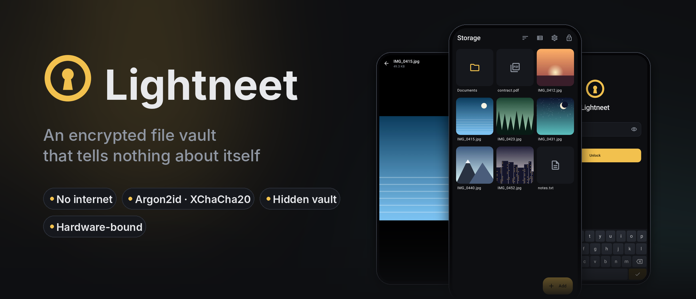
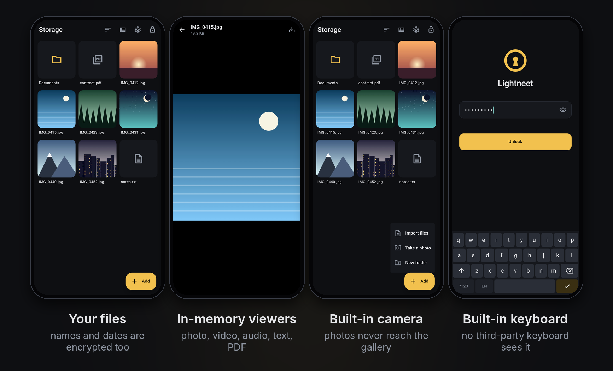
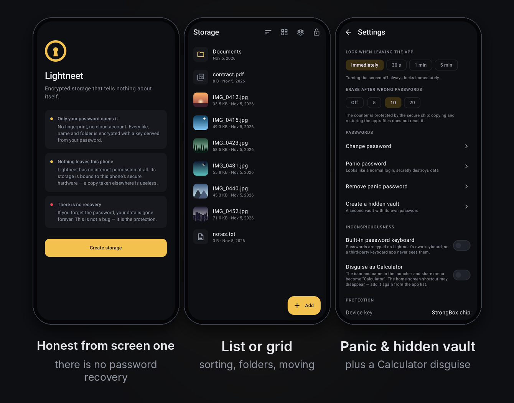
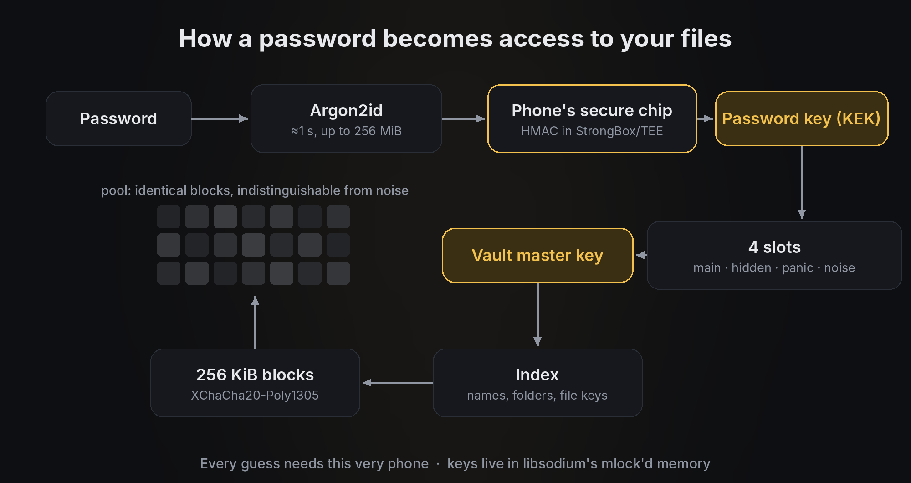

<p align="center">
  
</p>

<p align="center">
  <a href="https://github.com/myfreeze-art/Lightneet/releases"></a>
  
  
  <a href="LICENSE"></a>
</p>

<p align="center">
  <a href="README.md">Русский</a> · <b>English</b>
</p>

---

**Lightneet** is a vault for photos, videos and documents that nobody but you should see.
Everything inside is encrypted: file contents, names, folders, sizes and dates. From the
outside the storage looks like uniform random noise. The app has no internet access, no
accounts, no cloud, and no password recovery — by design.

<p align="center">
  
</p>

## Download

| | |
|---|---|
| 📦 **GitHub Releases** | Ready-to-install APK on the [**Releases**](https://github.com/myfreeze-art/Lightneet/releases) page. |
| 🤖 **F-Droid** | Submission in preparation. |

**How to install:**
1. Download `Lightneet-<version>.apk` to your phone.
2. Open it and allow installing from this source.
3. Choose a long password — four or five random words work well.

Requires **Android 9 or newer**. You can verify the APK against the SHA-256 and signing
certificate listed in each release ([how](docs/RELEASING.md#проверка-apk-пользователем)).

> [!IMPORTANT]
> Pick **one** update source — GitHub or F-Droid — and stick to it. The builds are signed with
> different keys, and Android will not install one over the other: you would have to uninstall
> the app, and the vault with it.

## Features

<table>
<tr>
<td width="50%" valign="top">

### 🔐 Encryption
- **Everything is encrypted**: files, names, folders, sizes, dates.
- **Password only**: no fingerprint, no cloud. Argon2id + XChaCha20-Poly1305 (libsodium).
- **Bound to the phone's chip**: every password check is signed by a non-extractable
  StrongBox/TEE key. No GPU brute force — not even with root.
- **Keys in guarded memory** from libsodium (`mlock`, guard pages), not in Java arrays.

</td>
<td width="50%" valign="top">

### 🕵️ If you are forced to open it
- **Hidden vault** with its own password, living in a reserve that always exists and always
  looks used — so the reserve proves nothing.
- **Panic password**: looks like a normal login, but silently destroys the hidden vault or
  everything.
- **Wrong-password limit**: after 10 attempts (configurable) everything is erased. Copying the
  app's files back does not reset the counter.

</td>
</tr>
<tr>
<td valign="top">

### 📷 Nothing bypasses the vault
- **Built-in camera**: photos are encrypted straight from memory and never reach the gallery.
- **In-memory viewers**: photos, seekable video, audio, text and PDF — no temporary files.
- **Import via "Share"** from any app, then delete the originals.
- **Deleted stays deleted**: an old copy of the storage will not reveal deleted files, even if
  the password leaks later.

</td>
<td valign="top">

### 🛡️ Hardened interface
- **Built-in password keyboard**: third-party keyboards never see your password.
- **"Calculator" disguise** in the launcher and the share menu.
- No screenshots, blank recent-apps preview, locks as soon as the screen turns off.
- On lock the app process **ends completely**, so nothing lingers in memory.
- **No network**: there is no `INTERNET` permission at all.

</td>
</tr>
</table>

<p align="center">
  
</p>

## How it works

<p align="center">
  
</p>

1. **Password → Argon2id.** Each attempt costs about a second and up to 256 MiB of memory,
   which makes guessing expensive.
2. **The phone's chip.** The result is "peppered" with an HMAC computed inside StrongBox/TEE.
   Without this very phone the next step is impossible, so a copied vault is useless.
3. **The password key opens one of four slots**: main, hidden, panic or noise. There are always
   four, and unused ones are indistinguishable from used ones.
4. **The vault's master key** decrypts the index: names, folders and file keys.
5. **Files** live in a pool of identical 256 KiB blocks, each encrypted with
   XChaCha20-Poly1305. Free blocks are filled with noise, so the disk does not reveal how much
   you store.

In depth: the [storage format](docs/SPEC.md) and the [threat model](docs/THREAT_MODEL.md) —
what Lightneet protects against, and what it does not.

## FAQ

<details>
<summary><b>I forgot my password. What now?</b></summary>

Nothing can be done: the data is gone for good. There is no recovery — not for you, not for the
developer. If there were, someone else could use it too.
</details>

<details>
<summary><b>How do I move my vault to a new phone?</b></summary>

The vault is bound to this phone's chip, so it cannot be copied — that is part of the
protection. Export the files you need, move them, import them on the new phone and delete the
exported copies right away.
</details>

<details>
<summary><b>Why no fingerprint unlock?</b></summary>

A fingerprint can be taken by force or while you sleep; a password in your head cannot. And the
key is derived from the password — without it there is nothing to derive the key from.
</details>

<details>
<summary><b>Can someone tell that I have a hidden vault?</b></summary>

Not from a single image of the phone's storage: the reserve for a hidden vault always exists and
always looks used. With two images taken at different times, one can see that reserve blocks
changed. Every deniable-encryption design shares this limitation; it is documented in the
[threat model](docs/THREAT_MODEL.md).
</details>

<details>
<summary><b>Why does the app ask for camera access?</b></summary>

Only for the built-in camera: photos are encrypted at once and never pass through the gallery.
The permission is not requested until you open the camera.
</details>

## Project status

> [!WARNING]
> Lightneet is **beta software**. The code was written with AI assistance (Claude) under the
> author's direction and has **not been independently audited**. The self-review and known
> limitations are in the [threat model](docs/THREAT_MODEL.md). Do not keep the only copy of
> important files here. If you know cryptography, a review is very welcome.

## Building from source

You need **JDK 21** and the Android SDK (installing Android Studio is easiest).

```bash
git clone https://github.com/myfreeze-art/Lightneet.git && cd Lightneet
./gradlew :core:jvmTest              # core tests against the real libsodium
./gradlew :app:testDebugUnitTest     # end-to-end app tests (Robolectric)
./gradlew :app:assembleDebug         # APK → app/build/outputs/apk/debug/
```

Releases are built by GitHub Actions on `v*` tags — see [`docs/RELEASING.md`](docs/RELEASING.md).

```
core/   Kotlin Multiplatform: crypto, format, blocks, vaults. No Android dependency.
app/    The Android app, built with Jetpack Compose.
docs/   Storage format, threat model, release process.
```

## Roadmap

- [x] Built-in camera, password keyboard and in-memory PDF viewer
- [x] "Calculator" disguise
- [x] All keys in libsodium's `mlock`'d memory
- [x] Signed releases in CI, metadata for F-Droid and Google Play
- [ ] Publication on F-Droid and Google Play
- [ ] Independent security audit
- [ ] iOS version on the same `core` (Secure Enclave instead of StrongBox)

## License

[GPL-3.0](LICENSE). Every fork must stay open source too.
