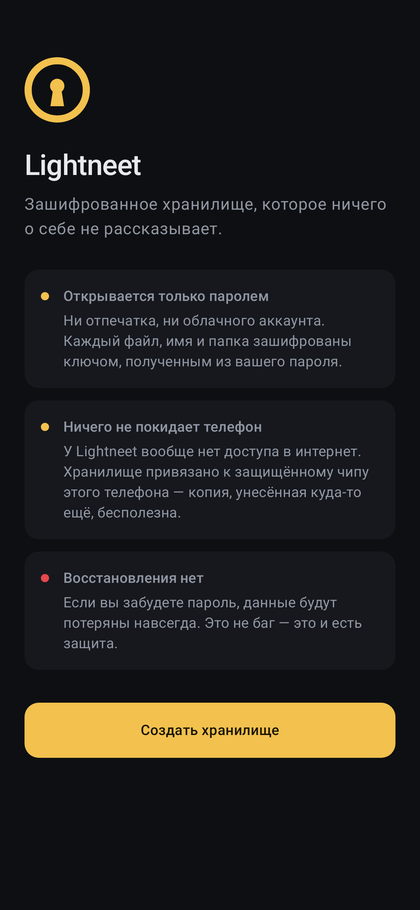
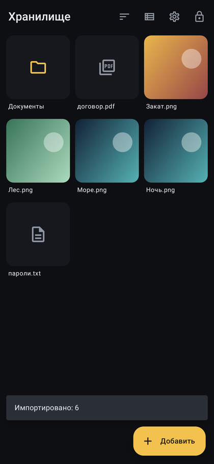
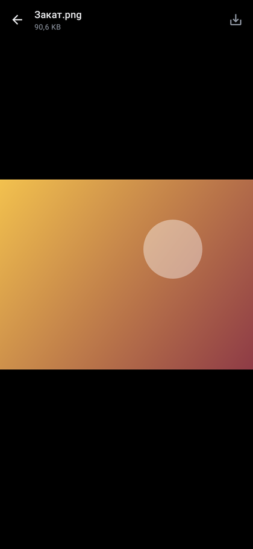
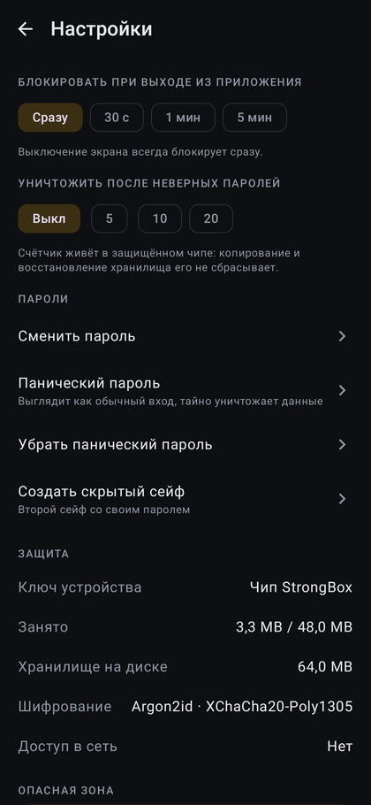

# Lightneet

**Зашифрованное файловое хранилище для Android, которое ничего о себе не рассказывает.**
*An encrypted file vault for Android that tells nothing about itself.* ([English below](#english))

<p>




</p>

## Что это

Lightneet хранит файлы любого размера в зашифрованном виде. Открыть их может только тот, кто
знает пароль. Восстановления пароля нет, и это сделано сознательно.

- **Шифруется всё:** содержимое файлов, их имена, папки, размеры и даты. Снаружи хранилище
  выглядит как однородный шум.
- **Только пароль.** Ни отпечатка, ни облака. Пароль превращается в ключ через Argon2id, данные
  шифруются через XChaCha20-Poly1305 (libsodium).
- **Привязка к чипу телефона.** Заголовок дополнительно запечатан ключом Android Keystore /
  StrongBox. Копия хранилища, вынесенная с телефона, бесполезна: подбирать пароль на
  видеокартах невозможно.
- **Скрытый сейф.** Второй сейф со своим паролем живёт в резерве, который существует всегда и
  всегда выглядит занятым.
- **Панический пароль.** Выглядит как обычный вход, но незаметно уничтожает скрытый сейф или
  вообще всё.
- **Лимит попыток.** После N неверных паролей всё стирается. Счётчик нельзя сбросить
  копированием и восстановлением файлов: ключ устройства меняется при каждой попытке.
- **Никакой сети.** У приложения нет разрешения `INTERNET`.
- **Расшифрованные данные живут только в памяти.** Встроенные просмотрщики для фото, видео (с
  перемоткой), аудио и текста работают без временных файлов. Ключи стираются при блокировке.
- **Защита интерфейса:** запрет скриншотов, пустое превью в списке недавних приложений,
  автоблокировка при сворачивании и выключении экрана, клавиатура не запоминает пароль.

Подробности:
- [`docs/SPEC.md`](docs/SPEC.md) — формат хранения;
- [`docs/THREAT_MODEL.md`](docs/THREAT_MODEL.md) — от чего приложение защищает, а от чего нет.

## Устройство проекта

```
core/   Kotlin Multiplatform: криптография, формат, блочный пул, сейфы.
        Не зависит от Android → готово к iOS.
app/    Android-приложение (Jetpack Compose).
docs/   спецификация и модель угроз.
```

## Сборка

Нужны JDK 17+ и Android SDK (проще всего через Android Studio).

```bash
./gradlew :core:jvmTest              # тесты ядра на настоящем libsodium
./gradlew :app:testDebugUnitTest     # сквозной тест приложения (Robolectric)
./gradlew :app:assembleDebug         # APK: app/build/outputs/apk/debug/
```

Минимальная версия Android — 9 (API 28).

## Дорожная карта

- [ ] Встроенная камера: снимки сразу шифруются и не попадают в галерею.
- [ ] Встроенная клавиатура для пароля, чтобы не зависеть от сторонних клавиатур.
- [ ] Ключи только в `mlock`-памяти libsodium, а не в массивах JVM.
- [ ] Просмотр PDF в памяти.
- [ ] Маскировка иконки (например, под «Калькулятор»).
- [ ] Release-подпись, F-Droid, Google Play.
- [ ] iOS-версия на том же `core` (Secure Enclave вместо StrongBox).

## Лицензия

[GPL-3.0](LICENSE): форки тоже обязаны оставаться открытыми.

---

## English

Lightneet stores files of any size encrypted with a key derived from your password (Argon2id →
XChaCha20-Poly1305, via libsodium). Names, folders, sizes and dates are encrypted too.

The storage is a pool of identical random-looking blocks. Its header is additionally sealed by a
non-exportable Android Keystore/StrongBox key that rotates on every unlock attempt. As a result:

- copies taken off the phone are useless;
- the wrong-password limit cannot be reset by restoring files;
- destroying the key is a reliable erase.

Lightneet also supports a deniable **hidden vault**, a **panic password** that silently destroys
data, and has **no network permission** at all.

See [`docs/SPEC.md`](docs/SPEC.md) and [`docs/THREAT_MODEL.md`](docs/THREAT_MODEL.md).
Build with `./gradlew :app:assembleDebug`; test with
`./gradlew :core:jvmTest :app:testDebugUnitTest`.
