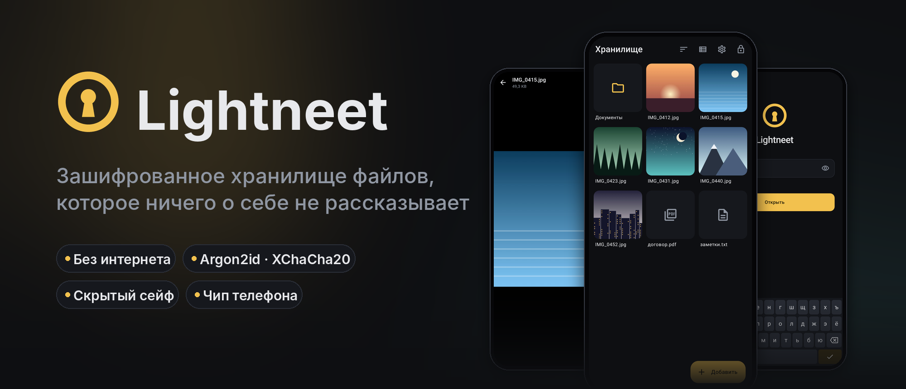
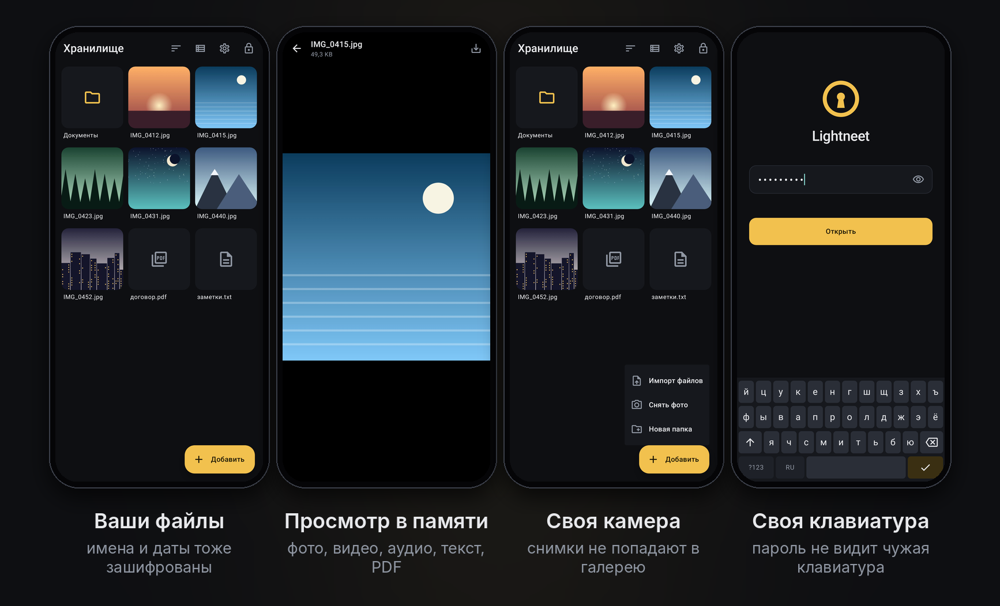
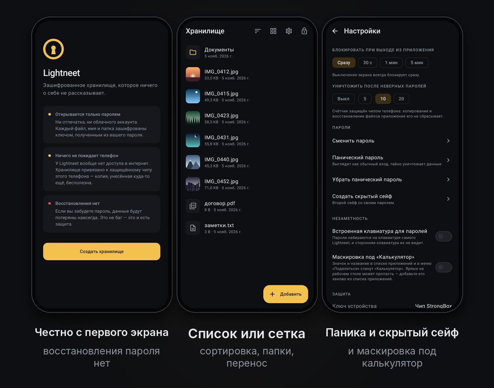
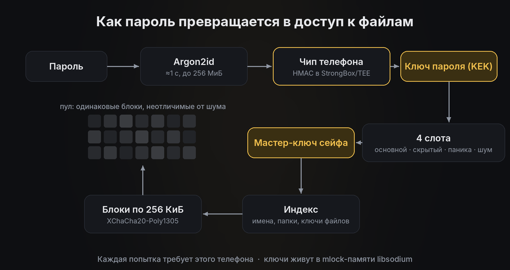

<p align="center">
  
</p>

<p align="center">
  <a href="https://github.com/myfreeze-art/Lightneet/releases"></a>
  
  
  <a href="LICENSE"></a>
</p>

<p align="center">
  <b>Русский</b> · <a href="README.en.md">English</a>
</p>

---

**Lightneet** — хранилище для фото, видео и документов, которые не должен видеть никто, кроме
вас. Всё внутри зашифровано: содержимое файлов, имена, папки, размеры и даты. Снаружи хранилище
выглядит как однородный случайный шум. У приложения нет доступа в интернет, нет аккаунтов и
облака, и нет восстановления пароля — это сделано сознательно.

<p align="center">
  
</p>

## Скачать

| | |
|---|---|
| 📦 **GitHub Releases** | Готовый APK — на странице [**Releases**](https://github.com/myfreeze-art/Lightneet/releases). |
| 🤖 **F-Droid** | Заявка готовится. |

**Как установить:**
1. Скачайте `Lightneet-<версия>.apk` на телефон.
2. Откройте файл и разрешите установку из этого источника.
3. Придумайте длинный пароль — например, четыре-пять случайных слов.

Нужен **Android 9 или новее**. Подлинность APK можно проверить по SHA-256 и сертификату из
описания релиза ([как](docs/RELEASING.md#проверка-apk-пользователем)).

> [!IMPORTANT]
> Выберите **один** источник обновлений — GitHub или F-Droid — и не меняйте его. Сборки
> подписаны разными ключами, и Android не даст поставить одну поверх другой: придётся удалить
> приложение, а вместе с ним и хранилище.

## Возможности

<table>
<tr>
<td width="50%" valign="top">

### 🔐 Шифрование
- **Шифруется всё**: файлы, имена, папки, размеры, даты.
- **Только пароль**: ни отпечатка, ни облака. Argon2id + XChaCha20-Poly1305 (libsodium).
- **Привязка к чипу телефона**: каждую проверку пароля подписывает ключ из StrongBox/TEE,
  который нельзя извлечь. Подбирать пароль на видеокартах нельзя, даже с root-доступом.
- **Ключи в защищённой памяти** libsodium (`mlock`, guard-страницы), а не в массивах Java.

</td>
<td width="50%" valign="top">

### 🕵️ Если заставят открыть
- **Скрытый сейф** со своим паролем. Он живёт в резерве, который есть всегда и всегда выглядит
  занятым, поэтому существование резерва ничего не доказывает.
- **Панический пароль**: выглядит как обычный вход, но незаметно уничтожает скрытый сейф или всё.
- **Лимит неверных паролей**: после 10 попыток (настраивается) всё стирается. Счётчик нельзя
  сбросить копированием файлов приложения.

</td>
</tr>
<tr>
<td valign="top">

### 📷 Ничего мимо хранилища
- **Своя камера**: снимки шифруются прямо из памяти и не попадают в галерею.
- **Просмотр в памяти**: фото, видео с перемоткой, аудио, текст и PDF — без временных файлов.
- **Импорт через «Поделиться»** из любого приложения и удаление оригиналов после импорта.
- **Удалённое не воскресает**: старая копия хранилища не раскроет удалённые файлы, даже если
  потом узнать пароль.

</td>
<td valign="top">

### 🛡️ Защита интерфейса
- **Своя клавиатура для пароля**: сторонняя клавиатура его не увидит.
- **Маскировка под «Калькулятор»** в списке приложений и в меню «Поделиться».
- Запрет скриншотов, пустое превью в «Недавних», автоблокировка при выключении экрана.
- После блокировки процесс приложения **завершается целиком**, чтобы в памяти ничего не осталось.
- **Никакой сети**: разрешения `INTERNET` нет вообще.

</td>
</tr>
</table>

<p align="center">
  
</p>

## Как это устроено

<p align="center">
  
</p>

1. **Пароль → Argon2id.** На каждую попытку уходит около секунды и до 256 МиБ памяти:
   перебор становится дорогим.
2. **Чип телефона.** Результат дополнительно «перчится» HMAC внутри StrongBox/TEE. Без этого
   конкретного телефона следующий шаг невозможен, поэтому скопированное хранилище бесполезно.
3. **Ключ пароля открывает один из четырёх слотов**: основной, скрытый, панический или шум.
   Слотов всегда четыре, и неиспользуемые неотличимы от занятых.
4. **Мастер-ключ сейфа** расшифровывает индекс: имена, папки и ключи файлов.
5. **Файлы** лежат в пуле одинаковых блоков по 256 КиБ, каждый зашифрован XChaCha20-Poly1305.
   Свободные блоки заполнены шумом, так что по диску не понять, сколько вы храните.

Подробно: [формат хранения](docs/SPEC.md) и [модель угроз](docs/THREAT_MODEL.md) — от чего
Lightneet защищает и от чего нет.

## Частые вопросы

<details>
<summary><b>Я забыл пароль. Что делать?</b></summary>

Ничего: данные потеряны навсегда. Восстановления нет ни у вас, ни у разработчика. Если бы оно
было, им мог бы воспользоваться и кто-то другой.
</details>

<details>
<summary><b>Как перенести хранилище на новый телефон?</b></summary>

Хранилище привязано к чипу этого телефона, поэтому скопировать его нельзя — это часть защиты.
Экспортируйте нужные файлы, перенесите их, импортируйте на новом телефоне и сразу удалите
экспортированные копии.
</details>

<details>
<summary><b>Почему нет входа по отпечатку?</b></summary>

Отпечаток можно получить силой или пока вы спите, а пароль из головы — нет. Кроме того, ключ
выводится из пароля: без пароля его просто не из чего получить.
</details>

<details>
<summary><b>Видно ли, что у меня есть скрытый сейф?</b></summary>

По одному снимку памяти телефона — нет: резерв под скрытый сейф существует всегда и выглядит
занятым. Если же снять копию памяти дважды, можно заметить, что блоки резерва изменились. Это
ограничение любого подобного шифрования, и оно честно описано в
[модели угроз](docs/THREAT_MODEL.md).
</details>

<details>
<summary><b>Почему приложение просит доступ к камере?</b></summary>

Только для встроенной камеры: снимки сразу шифруются и не проходят через галерею. Пока камеру
не открыли, разрешение не запрашивается.
</details>

## Статус проекта

> [!WARNING]
> Lightneet — **бета-версия**. Код написан с помощью ИИ (Claude) под руководством автора и
> **не проходил независимый аудит безопасности**. Результаты самопроверки и известные
> ограничения описаны в [модели угроз](docs/THREAT_MODEL.md). Не храните здесь единственные
> копии важных файлов. Если вы разбираетесь в криптографии, ревью очень приветствуется.

## Сборка из исходников

Нужны **JDK 21** и Android SDK (проще всего поставить Android Studio).

```bash
git clone https://github.com/myfreeze-art/Lightneet.git && cd Lightneet
./gradlew :core:jvmTest              # тесты ядра на настоящем libsodium
./gradlew :app:testDebugUnitTest     # сквозные тесты приложения (Robolectric)
./gradlew :app:assembleDebug         # APK → app/build/outputs/apk/debug/
```

Релизы собирает GitHub Actions по тегу `v*` — см. [`docs/RELEASING.md`](docs/RELEASING.md).

```
core/   Kotlin Multiplatform: криптография, формат, блоки, сейфы. Не зависит от Android.
app/    Android-приложение на Jetpack Compose.
docs/   формат хранения, модель угроз, выпуск релизов.
```

## Дорожная карта

- [x] Встроенная камера, клавиатура для пароля и просмотр PDF в памяти
- [x] Маскировка под «Калькулятор»
- [x] Все ключи в `mlock`-памяти libsodium
- [x] Подписанные релизы в CI, метаданные для F-Droid и Google Play
- [ ] Публикация в F-Droid и Google Play
- [ ] Независимый аудит безопасности
- [ ] iOS-версия на том же `core` (Secure Enclave вместо StrongBox)

## Лицензия

[GPL-3.0](LICENSE). Любой форк тоже обязан оставаться открытым.
