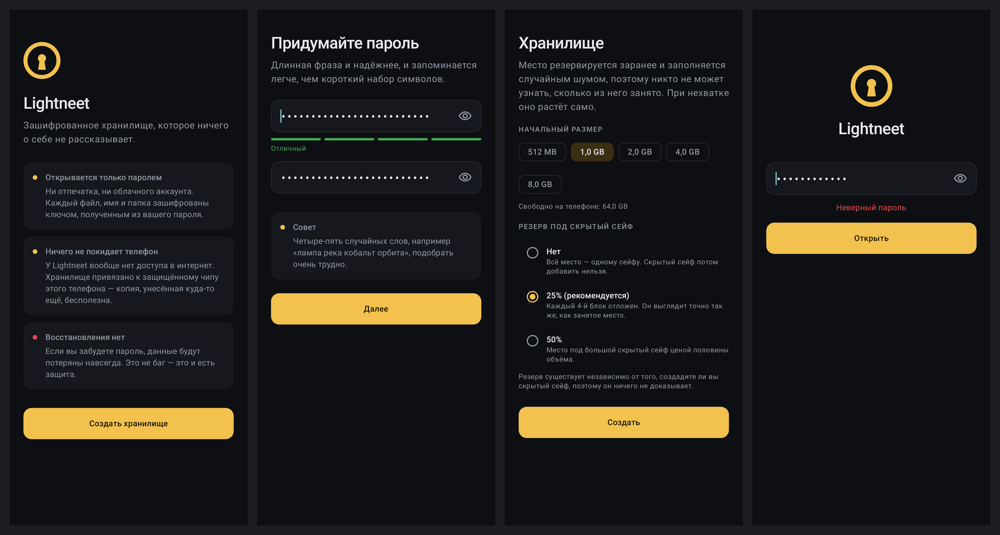
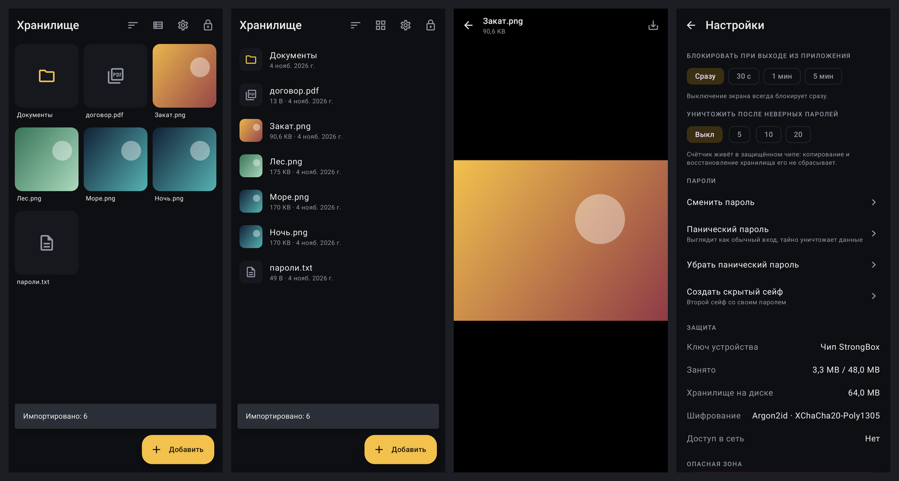

# Lightneet MVP: как это устроено

PR: [#1](https://github.com/myfreeze-art/Lightneet/pull/1) · формат: [SPEC.md](SPEC.md) · угрозы: [THREAT_MODEL.md](THREAT_MODEL.md)




*Скриншоты сняты автоматически сквозным тестом `AppFlowTest` (Robolectric + Roborazzi).*

## Background

### Для начинающих: что вообще значит «зашифровать»

Шифрование превращает данные в шум, который можно вернуть обратно, только зная ключ. Ключ — это
32 случайных байта. Запомнить такое нельзя, поэтому ключ *выводят* из пароля. Для этого нужна
функция, которая работает нарочно медленно, чтобы перебор паролей стоил дорого.

> 💡 **Argon2id** — функция вывода ключа из пароля. Каждый её запуск занимает около секунды и
> сотни мегабайт памяти. Для владельца это секунда при входе. Для атакующего — секунда на
> *каждую* догадку, причём видеокарты почти не ускоряют этот процесс: они упираются в память.

Сами данные шифруются **AEAD**-шифром (у нас XChaCha20-Poly1305). Он не только прячет данные, но и
замечает любую подмену: если хоть один бит изменён, расшифровка честно падает, а не выдаёт мусор.

В Android есть **Keystore**: место, где ключ живёт внутри защищённого железа (TEE или отдельного
чипа StrongBox). Приложение может *попросить* чип зашифровать что-то этим ключом, но вынуть сам
ключ не может никто.

### Конкретно для этого проекта

Репозиторий был пустым, поэтому «существующей системы» нет. Есть требования, которые мы обсудили:

- шифруется всё, открыть можно только паролем, восстановления нет;
- файлы любого размера, данные живут только на телефоне;
- обязательны «параноидальные» функции: скрытый сейф, панический пароль, стирание после N попыток;
- открытый код, потом Google Play, а в будущем, возможно, iOS.

Из последнего пункта следует архитектура: всё ценное (криптография и формат) лежит в модуле
`core` на Kotlin Multiplatform. Модуль `app` — это только Android-интерфейс поверх него.

## Intuition

Ключевая идея: **хранилище должно выглядеть одинаково, что бы в нём ни лежало**.

Представим игрушечный пул из 8 блоков с резервом 25%: каждый 4-й блок принадлежит скрытому сейфу.

```
индекс:   0    1    2    3    4    5    6    7
регион:  осн  осн  осн  скр  осн  осн  осн  скр
содерж.: SB-A SB-B фото SB-A инд. шум  шум  SB-B
```

Снаружи все 8 блоков — 256 КБ случайных на вид байтов. Шум в блоках 5 и 6 записан при создании
хранилища, шифротекст в остальных неотличим от шума. Основной сейф знает только «свои» блоки
0, 1, 2, 4. Про блоки 3 и 7 он не знает, есть ли там вообще что-то, и никогда туда не пишет.

> 🧩 **Почему резерв чередуется, а не лежит в конце.** Пул растёт по мере надобности. Если бы
> скрытый сейф жил «в конце», то после роста пула он оказался бы посередине, и основной сейф начал
> бы его затирать. При чередовании «каждый 4-й блок» правило сохраняется при любом размере пула,
> и столкновение невозможно в принципе.

Пароли устроены так же. В заголовке всегда 4 слота по 136 байт:

| Слот | Если используется | Если нет |
|---|---|---|
| 0 | основной сейф | — (всегда есть) |
| 1 | панический пароль | 136 случайных байт |
| 2 | скрытый сейф | 136 случайных байт |
| 3 | запас | 136 случайных байт |

При вводе пароля Argon2 запускается **один раз**, и полученным ключом пробуются **все четыре**
слота. Время ответа одинаковое для любого пароля, а по самому заголовку невозможно понять, сколько
слотов заняты.

Третья идея — **ключ устройства меняется при каждой попытке**:

```
попытка №1: header.bin запечатан ключом K1
  → счётчик++ → перезапечатать ключом K2 → удалить K1 из чипа
```

Если кто-то скопировал `header.bin` до попытки, а потом вернул копию обратно, копия запечатана K1,
а K1 уже уничтожен в чипе. Откат не обнуляет счётчик, а окончательно ломает хранилище.

## Code

### 1. Криптография: тонкая обёртка над libsodium

`core/.../crypto/Crypto.kt` — интерфейс из пяти операций. Реализация `SodiumCrypto` общая для JVM и
Android и отличается только загрузчиком нативной библиотеки:

```kotlin
interface Crypto {
    fun argon2id(password: ByteArray, salt: ByteArray, opsLimit: Long, memLimitBytes: Long): ByteArray
    fun seal(out: ByteArray, plaintext: ByteArray, ad: ByteArray, nonce: ByteArray, key: ByteArray)
    fun open(out: ByteArray, ciphertext: ByteArray, ad: ByteArray, nonce: ByteArray, key: ByteArray): Boolean
    fun keyedHash(key: ByteArray, message: ByteArray): ByteArray // для подключей
    fun fillRandom(target: ByteArray)
}
```

### 2. Заголовок и слоты

`format/Header.kt` описывает фиксированную раскладку на 592 байта. `storage/HeaderStore.kt` атомарно
записывает её с ротацией ключа:

```kotlin
fun writeRotating(header: Header, previousKeyId: String?): String {
    val keyId = device.createKey()          // новый ключ в StrongBox/TEE
    writeWith(keyId, header)                // tmp → fsync → rename
    if (previousKeyId != null) device.destroyKey(previousKeyId)
    return keyId
}
```

### 3. Блочный пул, индекс и суперблоки

`storage/BlockPool.kt` хранит сегменты по 64 МБ с блоками по 256 КБ. `vault/BlockStore.kt` содержит
три части:
- `BlockCodec`: `nonce | шифротекст | тег`, данные всегда дополнены до полного блока;
- `Allocator`: выдаёт свободные блоки только из своего региона;
- `IndexStore`: A/B-суперблоки.

Коммит индекса устроен так, чтобы сбой в любой момент оставлял корректное состояние:

```kotlin
val newBlocks = List(count) { allocator.allocate() }   // 1. новый индекс в новые блоки
... codec.write(...); pool.sync()
writeSuperblock(olderOfAB, generation + 1); pool.sync() // 2. точка фиксации
old.forEach { pool.scrub(it); allocator.release(it) }   // 3. старое — в шум
```

> ⚠️ **Граничный случай: импорт оборвался посередине.** Блоки данных пишутся до коммита индекса.
> Если поток упал или пользователь нажал «Отмена», уже записанные блоки перезаписываются шумом и
> освобождаются, а индекс остаётся прежним. Это проверяет тест `failedImportLeavesNoTrace`.

### 4. Алгоритм входа и паника

`vault/Vault.kt`, метод `unlock`. Счётчик увеличивается **до** проверки пароля: убийство процесса
посреди Argon2 попытку не отменяет.

```kotlin
h.failedAttempts++; persist()                    // ротация ключа устройства
val kek = crypto.argon2id(password, h.salt, ...)
val found = findSlot(kek, h)                     // всегда все 4 слота
when (payload.type) {
    MAIN, HIDDEN -> открыть сейф
    PANIC -> panic(...)  // слот 2 → шум (или всё → шум + новый пустой сейф)
}
```

Панический слот хранит мастер-ключ *основного* сейфа. Поэтому после уничтожения скрытого он
открывает основной, и со стороны это неотличимо от обычного входа.

### 5. Android-приложение

- `data/VaultHolder.kt` — владелец `Vault` и текущей сессии. Хранилище лежит в `noBackupFilesDir`,
  Argon2 получает 64–256 МБ в зависимости от RAM.
- `security/AutoLock.kt` блокирует при выключении экрана и уходе в фон. Для системного выбора
  файлов есть одноразовое исключение.
- `security/SecurePasswordField.kt` — поле на `EditText`: пароль читается в `CharArray`, кодируется и
  затирается. Обучение клавиатуры, автозаполнение и копирование отключены.
- `data/Transfers.kt` — потоковый импорт и экспорт через SAF, превью для фото (с учётом EXIF) и видео.
- `ui/viewer/ViewerScreen.kt` — свайп между файлами. Видео идёт через собственный `DataSource` для
  ExoPlayer, который расшифровывает нужный блок при перемотке.
- В манифесте `INTERNET` удаляется через `tools:node="remove"`, `allowBackup=false`, исключены все
  правила переноса данных.

## Verification

**Автоматически (всё зелёное):**

- `./gradlew :core:jvmTest` — 35 тестов на настоящем libsodium. Среди них:
  - тест-вектор Argon2id, посчитанный независимой реализацией (argon2-cffi);
  - откат `header.bin` → хранилище становится Unreadable;
  - χ²-тест: байты пула статистически неотличимы от шума;
  - основной сейф многократно растёт и удаляет файлы, а скрытый сейф остаётся цел;
  - оба режима паники, подмена блока, сбой посреди импорта.
- `./gradlew :app:testDebugUnitTest` — сквозной Robolectric-тест: настоящее приложение, libsodium
  через JNA, ViewModel и Compose. Тест создаёт хранилище, импортирует файлы и проверяет, что их
  текст не встречается в байтах на диске. Затем просмотр, настройки, блокировка, неверный и верный
  пароль, скрытый сейф.
- `lintDebug`, `assembleRelease` с R8 проходят. `aapt2 dump permissions` не показывает сетевых
  разрешений, все `.so` выровнены по 16 КБ.

> 🚧 **Не проверено на реальном железе.** В среде сборки нет KVM, поэтому эмулятор не
> запускался. Keystore в тестах подменён программной реализацией. Путь со StrongBox/TEE нужно
> проверить вручную на телефоне.

**Ручная проверка на телефоне:**

1. Установить `app-debug.apk` (или собрать: `./gradlew :app:installDebug`).
2. Создать хранилище с паролем из 4–5 слов, резерв 25%. Заполнение шумом займёт десятки секунд.
3. «Добавить → Импорт файлов» — выбрать фото и видео. Проверить превью, просмотр и перемотку видео.
4. Свернуть приложение → вернуться. Должен быть экран пароля. Выключить экран → то же самое.
5. Попробовать сделать скриншот: система должна запретить.
6. Настройки:
   - «Создать скрытый сейф» → заблокировать → войти скрытым паролем. Сейф пустой, заголовок тот
     же «Хранилище».
   - Задать панический пароль («Уничтожить скрытый сейф») → войти им. Откроется основной сейф, а
     скрытый пароль больше не работает.
7. Лимит попыток 5 → ввести 5 неверных паролей. Хранилище уничтожено, приложение предлагает
   создать новое.
8. «Настройки → Защита» показывает уровень ключа устройства (StrongBox или TEE).

## Alternatives

### A. Шифровать каждый файл отдельно (как Cryptomator)

| Плюсы | Минусы |
|---|---|
| Проще реализовать и отлаживать. | Видно количество файлов и размер каждого — это утечка. |
| Нет предварительного заполнения шумом, место расходуется ровно по размеру файлов. | Правдоподобное отрицание (скрытый сейф) фактически невозможно. |
| Легко синхронизировать отдельные файлы. | Удаление файла видно по исчезновению блока. |

### B. Ядро на Rust вместо Kotlin Multiplatform

| Плюсы | Минусы |
|---|---|
| Полный контроль над памятью: ключи в `mlock`, гарантированное затирание. | Два языка и FFI-слой (uniffi), сборка сложнее. |
| Одно ядро для Android, iOS и десктопа. | Медленнее разработка для одного-двух человек. |
| | Libsodium всё равно нужен, выигрыш в основном в управлении памятью. |

## Suggested people to talk to

Репозиторий новый. Единственный коммит до этого PR — `Initial commit` от владельца репозитория
(myfreeze-art), так что людей с контекстом по этому коду пока нет. Вот какая экспертиза
пригодится:

- **Специалист по прикладной криптографии / аудитор:** проверить `docs/SPEC.md`, особенно схему
  слотов и ротацию ключа устройства, до публичного релиза.
- **Android-разработчик с опытом Keystore/StrongBox:** проверить поведение на разных
  производителях (Samsung, Pixel, Xiaomi), особенно скорость генерации ключей в StrongBox.

## Quiz

<details>
<summary><b>1. Почему счётчик неверных попыток увеличивается до запуска Argon2, а не после?</b></summary>

- A) Так быстрее.
- B) Чтобы убийство процесса посреди проверки не позволило попробовать пароль бесплатно. ✅
- C) Потому что Argon2 портит память.

**Ответ: B.** Если бы счётчик рос после проверки, атакующий мог бы ввести пароль, увидеть
результат по косвенным признакам и убить процесс до записи. Тогда попытка не засчиталась бы.
A неверно: порядок на скорость не влияет. C неверно: Argon2 ничего не портит.
</details>

<details>
<summary><b>2. Злоумышленник скопировал header.bin, ввёл 4 неверных пароля из 5 и вернул копию на место. Что произойдёт?</b></summary>

- A) Счётчик обнулится, и он получит ещё 5 попыток.
- B) Хранилище станет нечитаемым (Unreadable): копия запечатана ключом, который уже уничтожен в
  чипе. ✅
- C) Приложение заметит подмену по контрольной сумме и восстановит счётчик.

**Ответ: B.** Каждая попытка перезапечатывает заголовок новым ключом устройства и удаляет старый.
Вернув старую копию, злоумышленник окончательно ломает хранилище, а не обнуляет счётчик. Это
проверяет тест `restoringAnOldHeaderCopyDoesNotResetTheCounter`.
</details>

<details>
<summary><b>3. Почему резерв скрытого сейфа — «каждый 4-й блок», а не «последние 25% пула»?</b></summary>

- A) Так проще считать индексы.
- B) Пул растёт, и «последние 25%» после роста оказались бы посередине, где их затёр бы основной
  сейф. ✅
- C) Каждый 4-й блок шифруется сильнее.

**Ответ: B.** Чередование сохраняет принадлежность блока региону при любом размере пула, поэтому
столкновение невозможно. C неверно: все блоки шифруются одинаково.
</details>

<details>
<summary><b>4. Что делает панический пароль в режиме «Уничтожить скрытый сейф»?</b></summary>

- A) Удаляет все файлы скрытого сейфа по одному.
- B) Заполняет слот 2 случайными байтами, меняет ключ устройства и открывает основной сейф
  мастер-ключом, хранящимся в паническом слоте. ✅
- C) Показывает сообщение «данные уничтожены».

**Ответ: B.** Это криптографическое стирание: без мастер-ключа блоки скрытого сейфа становятся
шумом, удалять их по одному не нужно, и это мгновенно. C — ровно то, чего делать нельзя: снаружи
вход должен выглядеть обычным.
</details>

<details>
<summary><b>5. Импорт видео на 3 ГБ оборвался на середине. В каком состоянии хранилище?</b></summary>

- A) Повреждено, нужно восстанавливать.
- B) Файл виден наполовину.
- C) Как до импорта: записанные блоки перезаписаны шумом и освобождены, индекс не менялся. ✅

**Ответ: C.** Блоки данных пишутся до коммита индекса, а точка фиксации — запись нового
суперблока. Пока её нет, файла в индексе нет. При ошибке `importFile` затирает уже записанные
блоки.
</details>
