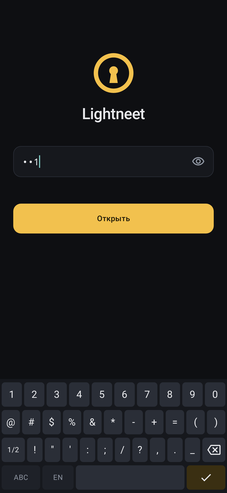
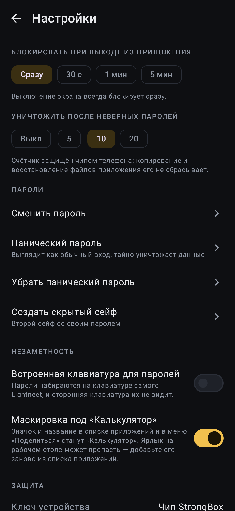

# Lightneet 0.3: дорожная карта

Камера, встроенная клавиатура, PDF, маскировка, ключи в защищённой памяти, метаданные для магазинов.

> Всё, что можно было сделать и проверить без телефона, сделано. Что осталось за людьми — в конце раздела «Проверка».

## Предыстория

### Для тех, кто видит проект впервые

Lightneet — зашифрованное хранилище файлов для Android. Все файлы, их имена и папки лежат в «пуле» одинаковых блоков, неотличимых от случайного шума. Открыть хранилище можно только паролем: пароль через Argon2id превращается в ключ, который дополнительно «перчится» секретом из чипа телефона (Keystore/StrongBox). Поэтому подбирать пароль можно только на этом самом телефоне, по секунде на попытку, и не больше 10 раз.

Проект разделён на две части:

- `core/` — Kotlin Multiplatform: криптография, формат, блоки, сейфы. От Android не зависит, поэтому годится и для будущей iOS-версии.
- `app/` — Android-приложение на Jetpack Compose.

Главный принцип приложения: **открытый текст живёт только в оперативной памяти**. Просмотрщики фото и видео читают файл прямо из хранилища, без временных файлов, а при блокировке процесс приложения завершается целиком, чтобы ОС забрала всю его память.

> 💡 **Ключевое понятие — «граница открытого текста».** Любая новая функция оценивается одним вопросом: где окажутся расшифрованные байты и кто ещё их увидит? Галерея, сторонняя клавиатура, временный файл, swap — всё это места, куда данные утекать не должны.

### Что было не сделано

В README оставалась дорожная карта из семи пунктов: встроенная камера, встроенная клавиатура, ключи в `mlock`-памяти, PDF в памяти, маскировка значка, публикация (F-Droid/Google Play) и iOS. Этот PR закрывает пять с половиной из них. iOS не сделана: для неё нужен Mac с Xcode. Публикацию в магазинах может выполнить только владелец аккаунтов — всё для неё подготовлено.

## Интуиция

Все пять функций — одна и та же идея, применённая к разным «утечкам».

| Утечка | Было | Стало |
|---|---|---|
| Фото с камеры телефона | Снимок сначала ложится в галерею, потом его импортируют | Встроенная камера отдаёт JPEG буфером в памяти → он шифруется → буфер обнуляется |
| Пароль на сторонней клавиатуре | Клавиатура — чужое приложение, может логировать | Своя клавиатура вписывает символы прямо в поле пароля |
| PDF | Открыть можно только экспортом (то есть расшифровкой на диск) | PDF расшифровывается в анонимный файл в памяти (`memfd`) |
| Значок «Lightneet» на экране | Сразу видно, что за приложение | Значок и название можно заменить на «Калькулятор» |
| Ключи в куче JVM | `ByteArray`, которые JNA ещё и копирует при каждом вызове | Ключи в памяти libsodium: `mlock`, guard-страницы, только чтение |

Пример с ключами. Раньше шифрование блока выглядело так:

```kotlin
val key: ByteArray = …          // 32 байта в куче JVM
sodium.encrypt(…, key)          // JNA копирует key во временный нативный буфер и освобождает его, не обнуляя
```

Теперь:

```kotlin
val key: SecretKey = crypto.secretKey(bytes)   // bytes копируются в sodium_malloc и сразу обнуляются
crypto.seal(…, key)                            // libsodium получает указатель — копий нет
```

Результат шифрования **байт-в-байт тот же**: формат хранения не меняется, старые хранилища открываются.

## Код

### 1. Ключи в защищённой памяти (`core/`)

В `Crypto.kt` появился непрозрачный тип:

```kotlin
abstract class SecretKey : AutoCloseable {
    abstract val size: Int
    abstract val isClosed: Boolean
    internal abstract fun copyInto(dest: ByteArray, offset: Int = 0) // только для запечатывания в слот
    abstract override fun close()                                    // идемпотентно
}
```

`GuardedKey` в `SodiumCrypto.kt` выделяет память через `sodium_malloc`, заполняет её и переводит в «только чтение». Каждое использование держит монитор ключа, поэтому `close()` (то есть `sodium_free`) не может освободить память под работающей операцией. Использование закрытого ключа бросает исключение, а не роняет процесс.

lazysodium умеет передавать ключи только как `byte[]`, поэтому добавлен `SodiumNative.kt` — прямой JNA-маппинг нескольких функций libsodium с `Pointer` вместо массива. Он привязывается к той же библиотеке, что и lazysodium (`"sodium"` на Android и тот же `LibraryLoader` на JVM).

В `SecretKey` переведены мастер-ключи (`SlotPayload.masterKey`), ключи индекса и суперблоков (`IndexStore`) и KEK. KEK теперь вообще никогда не существует как массив JVM:

```kotlin
return crypto.secretKey(stretched).use { crypto.deriveKey(it, message) }
```

> ⚠️ **Что осталось массивами.** Ключи отдельных файлов — часть расшифрованного индекса (вместе с именами файлов), поэтому они пока остаются обычными `ByteArray`. Это записано в THREAT_MODEL и в дорожной карте отдельным пунктом.

### 2. Встроенная камера (`ui/camera/CameraScreen.kt`, `data/Photos.kt`)

CameraX с `OnImageCapturedCallback`: снимок приходит как `ImageProxy` в памяти, а не как файл. `encryptPhoto()` при необходимости поворачивает его (камера сообщает `rotationDegrees`) и перекодирует, что заодно стирает EXIF. Затем `importFile` → миниатюра → буфер обнуляется. Пункт «Снять фото» добавлен в меню «Добавить». Разрешение `CAMERA` запрашивается при первом открытии.

### 3. Встроенная клавиатура (`security/PasswordKeyboard.kt`)

Раскладки: латиница, кириллица и две страницы символов, плюс Shift (одно нажатие / Caps). Клавиатура пишет в поле, у которого сейчас фокус (`PasswordKeyboardTarget`), через новые `SecurePasswordState.type()` и `backspace()`. Символ передаётся через переиспользуемый `CharArray`, без создания `String`, а удаляемый символ сначала перезаписывается `\u0000`. Когда клавиатура включена, у `EditText` выключен `showSoftInputOnFocus`, и системная клавиатура не открывается. Включается в Настройки → «Незаметность»; работает на экранах разблокировки, создания хранилища и в диалогах смены паролей.



### 4. PDF в памяти (`ui/viewer/PdfPage.kt`)

`MemoryPdf.open()` потоково расшифровывает файл в `Os.memfd_create` — анонимный файл без пути, живущий только в RAM — и отдаёт его `PdfRenderer`. Страницы рендерятся лениво в `LazyColumn`. При уходе со страницы `memfd` обрезается до нуля и закрывается, даже если расшифровка ещё шла (`NonCancellable` + `awaitDispose`). Нужен Android 11+, файлы до 64 МиБ; иначе, как и раньше, предлагается экспорт.

### 5. Маскировка (`AndroidManifest.xml`, `security/LauncherDisguise.kt`)

`MainActivity` больше не точка входа. Вместо неё два `activity-alias`: `.Launcher` (Lightneet) и `.Calculator` (значок калькулятора, название «Калькулятор»). Включён ровно один. Фильтры «Поделиться» тоже перенесены на алиасы, чтобы и меню «Поделиться» показывало «Калькулятор». `RestartActivity`, который заново открывает приложение после блокировки, теперь идёт через `getLaunchIntentForPackage`, то есть через активный алиас, и в «Недавних» маскировка тоже сохраняется.



### 6. Публикация

- `fastlane/metadata/android/{en-US,ru-RU}` — название, описания, значок 512×512, скриншоты, список изменений `300.txt`. Этот формат читают и F-Droid, и `fastlane supply` для Play.
- `release.yml`: при настроенном постоянном ключе в релиз попадает ещё и `.aab` для Google Play.
- Без переменных CI `versionCode` вычисляется из `versionName` (0.3.0 → 300), как того требует сборка F-Droid.
- `docs/RELEASING.md` — пошаговые инструкции для fdroiddata и Play Console.

## Проверка

**Автоматически (в этой среде, с настоящим libsodium):**

- `:core:jvmTest` — 53 теста, включая новые: ключи в защищённой памяти дают **те же** шифротексты и подключи, что и массивы; источник обнуляется; закрытый ключ отказывает.
- `:app:testDebugUnitTest` (Robolectric) — 4 сквозных теста. Новые проверяют:
  - снимок камеры попадает в хранилище «стоя», с миниатюрой, а буфер обнулён; ни в хранилище, ни в `files`/`cache` нет открытого JPEG;
  - встроенная клавиатура: Shift, Backspace, символы, смена языка, ввод кириллического пароля и разблокировка кнопкой «Готово»; системная клавиатура выключена;
  - маскировка: в лаунчере остаётся только `Calculator` с подписью «Калькулятор», и intent перезапуска тоже указывает на него.
- `:app:lintDebug`, `:app:assembleRelease` (R8), `:app:bundleRelease` — без ошибок; в APK нет сетевых разрешений.
- Полная сборка с **пустым** кэшем Gradle: все новые зависимости проверены по SHA-256 из `verification-metadata.xml`.

> 🧪 **Не проверено на телефоне.** Эмулятора здесь нет (нет KVM), а Robolectric не умеет камеру, `memfd` и `PdfRenderer`. Нужна ручная проверка.

**Ручная проверка (Android 11+, debug-APK из артефактов CI):**

1. Обновление поверх 0.2.0-rc2: хранилище открывается старым паролем (формат не менялся). Если ярлык на рабочем столе пропал, добавьте его заново: точка входа сменилась.
2. Добавить → Снять фото → разрешить камеру → сделать 2–3 снимка, переключить камеру. Снимки появились в папке «стоя»; в Галерее телефона их нет.
3. Импортировать PDF → открыть: страницы листаются, текст чёткий. Пролистнуть на соседний файл, пока PDF ещё грузится, — приложение не падает.
4. Настройки → Незаметность → «Встроенная клавиатура» → заблокировать: системная клавиатура не появляется, своя печатает; «Готово» открывает хранилище. Проверить также смену пароля.
5. Включить маскировку: в списке приложений «Калькулятор», в меню «Поделиться» тоже. Заблокировать экран и открыть снова: в «Недавних» — «Калькулятор». Выключить маскировку — вернулся Lightneet.
6. Release-сборка (R8) на телефоне: разблокировка работает. Это главная проверка того, что JNA-маппинг `SodiumNative` пережил R8 на ARM.

## Альтернативы

**Клавиатура как отдельный IME-сервис** (своя `InputMethodService`)

| За | Против |
|---|---|
| Работала бы и в других приложениях | Пользователю нужно включать её в системных настройках |
| Обычное поведение Android: переключатель клавиатур | Другие приложения тоже могли бы её выбрать — лишняя поверхность атаки; отдельный сервис, своё окно |

**PDF через pdf.js в WebView**

| За | Против |
|---|---|
| Работает с Android 9, а не только с 11 | Большой JS-движок внутри приложения без сети — тяжело и много кода для аудита |
| Поиск по тексту, выделение | WebView — отдельный процесс рендеринга со своими кэшами |

**Все ключи, включая файловые, в guarded-памяти**

| За | Против |
|---|---|
| Полностью закрывает пункт дорожной карты | Индекс пришлось бы хранить в двух частях (метаданные отдельно, ключи отдельно) — смена формата |
| | По странице памяти на каждый файл, а лимит `RLIMIT_MEMLOCK` на Android небольшой |

## С кем поговорить

- **theysk** (владелец репозитория, сливал все PR) — решает, выпускать ли 0.3.0; у него доступ к секретам подписи, Play Console и GitLab для F-Droid.
- Код ядра и приложения до этого PR тоже написан Claude (PR #1–#6), так что других людей с глубоким знанием отдельных файлов в истории нет. Для настоящего аудита криптографии стоит позвать внешнего ревьюера — THREAT_MODEL прямо приглашает к этому.

## Квиз

<details><summary><b>1. Почему формат хранения не изменился, хотя все долгоживущие ключи переехали в другую память?</b></summary>

- A. Старые хранилища конвертируются при первом открытии — **неверно**, миграции нет.
- B. `SecretKey` подаёт в libsodium те же 32 байта, просто по указателю; шифротексты и подключи совпадают байт-в-байт — **верно**, это проверяет тест `guardedKeysMatchPlainKeys`.
- C. Ключи шифруются ещё раз ключом Keystore — **неверно**, ключи только перемещены в другую память.
</details>

<details><summary><b>2. Зачем понадобился свой <code>SodiumNative</code>, если lazysodium уже умеет <code>sodium_malloc</code>?</b></summary>

- A. lazysodium не умеет `sodium_malloc` — **неверно**, умеет.
- B. Функции шифрования в lazysodium принимают ключ только как `byte[]`: пришлось бы копировать ключ обратно в кучу JVM, а JNA при каждом вызове ещё делает необнуляемую нативную копию — **верно**.
- C. Ради скорости — **неверно**, скорость тут не главное.
</details>

<details><summary><b>3. Что произойдёт, если пролистнуть PDF, пока он ещё расшифровывается в <code>memfd</code>?</b></summary>

- A. `memfd` останется открытым до конца процесса — **неверно**, именно это исправлено.
- B. Открытие идёт в `NonCancellable`, результат всё равно возвращается, и `awaitDispose` обрезает и закрывает `memfd` — **верно**.
- C. Приложение упадёт с `CancellationException` — **неверно**.
</details>

<details><summary><b>4. Почему фильтры «Поделиться» перенесены с <code>MainActivity</code> на алиасы?</b></summary>

- A. Иначе меню «Поделиться» показывало бы «Lightneet» даже при включённой маскировке: там видна подпись компонента, у которого есть фильтр — **верно**.
- B. `MainActivity` теперь `exported=false` — отчасти верно, но это следствие, а главная причина в A.
- C. Этого требует CameraX — **неверно**.
</details>

<details><summary><b>5. Почему повёрнутый снимок перекодируется, а ровный — нет, и что это даёт?</b></summary>

- A. Перекодирование нужно для шифрования — **неверно**, шифруется любой массив байт.
- B. Камера сообщает поворот отдельно (`rotationDegrees`). Чтобы фото открывалось «стоя» без EXIF-флага, его поворачивают и пережимают в JPEG 95, попутно удаляя EXIF. Ровный снимок не трогают, чтобы не терять качество — **верно**.
- C. Чтобы уменьшить размер — **неверно**.
</details>
